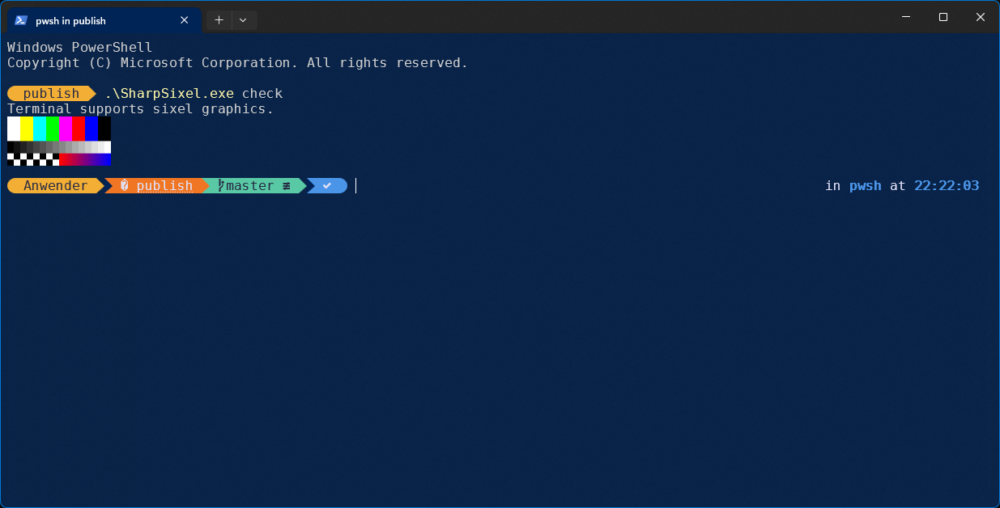

# SharpSixel

[English](README.md) | Deutsch

**Sixel-Grafiken für .NET: eine abhängigkeitsfreie Encoder-/Decoder-Bibliothek, PNG/JPEG-Unterstützung über SkiaSharp und ein Kommandozeilenprogramm, das Bilder direkt im Terminal anzeigt.**

[](https://github.com/feuster/SharpSixel/actions/workflows/dotnet.yml)
[](LICENSE)


[Sixel](https://en.wikipedia.org/wiki/Sixel) ist ein Bitmap-Grafikformat aus der Zeit der DEC-Terminals VT240/VT340.
Ein Bild wird durch druckbare Steuerzeichen beschrieben, sodass ein Terminal es direkt zeichnen kann, ohne externes
Anzeigeprogramm. Viele moderne Terminals unterstützen es (siehe [Terminal-Unterstützung](#terminal-unterstützung)).

```console
$ SharpSixel check
Terminal supports sixel graphics.
[ein kleines Testbild erscheint: Farbbalken, Graustufenverlauf, Schachbrett, Verlauf von Rot nach Blau]

$ SharpSixel encode foto.jpg --show --fit
[das Foto erscheint im Terminal, angepasst an die Fenstergröße]
```



*`SharpSixel check` im Windows Terminal: Das eingebaute Testbild wird als Sixel-Grafik gezeichnet.*

## Inhalt

- [Funktionen](#funktionen)
- [Schnellstart](#schnellstart)
- [Kommandozeile](#kommandozeile)
- [Bibliothek](#bibliothek)
- [Terminal-Unterstützung](#terminal-unterstützung)
- [Build, Tests, Publish](#build-tests-publish)
- [Projektstruktur](#projektstruktur)
- [Dokumentation](#dokumentation)
- [Grenzen und Status](#grenzen-und-status)
- [Spezifikationen](#spezifikationen)
- [Hinweis zur Nutzung von KI](#hinweis-zur-nutzung-von-ki-freiwillig)
- [Lizenz](#lizenz)

## Funktionen

**Encoder**
- Exakte Palette, wenn das Bild höchstens `MaxColors` Farben hat (bis 256), sonst Median-Cut-Quantisierung
- Dithering: Floyd-Steinberg (Fehlerdiffusion) oder geordnet mit 8x8-Bayer-Matrix (schneller, kleinere Ausgabe)
- Lauflängenkodierung, Raster Attributes (Größe und Seitenverhältnis), Transparenz (`P2 = 1`)

**Decoder**
- Vollständiges DECSIXEL: Farbregister (RGB und HLS mit der DEC-Farbtonkonvention), Wiederholung, Raster Attributes,
  Pixel-Seitenverhältnis, Hintergrundwahl, 7-Bit- und 8-Bit-Steuersequenzen
- Tolerant gegenüber unbekannten Zeichen und Zeilenumbrüchen; Größenlimits schützen vor fehlerhaften oder
  böswilligen Daten

**Weitere Bibliotheksfunktionen**
- `BmpCodec`: BMP lesen (1/4/8/16/24/32 Bit) und schreiben, eingebaut, ohne Abhängigkeiten
- `ImageScaler`: Flächenmittelwert beim Verkleinern, bilinear beim Vergrößern, Alpha-gewichtet
- `SixelTerminal`: Erkennung der Sixel-Unterstützung (DA1) und Abfrage der Pixelgröße, unabhängig von der
  Konsolen-Ein-/Ausgabe
- `SharpSixel.Skia`: PNG, JPEG und weitere Formate über [SkiaSharp](https://github.com/mono/SkiaSharp) (MIT)

**Kommandozeile**
- `encode`, `decode`, `check`; Bilder im Terminal anzeigen (`--show`), ans Fenster anpassen (`--fit`)
- Einzelne, eigenständige Windows-Exe, keine .NET-Installation nötig

## Schnellstart

Repository klonen und die eigenständige Exe, die NuGet-Pakete und die Anleitungen nach `publish/` bauen
(benötigt das .NET-10-SDK):

```powershell
git clone https://github.com/feuster/SharpSixel.git
cd SharpSixel
./publish.ps1
```

Danach:

```powershell
cd publish
.\SharpSixel.exe check                              # unterstützt das Terminal Sixel? zeigt ein Testbild
.\SharpSixel.exe encode foto.jpg --show --fit       # Foto anzeigen, ans Terminal angepasst
.\SharpSixel.exe encode foto.png --width 800 --colors 64 --dither bayer -o foto.six
.\SharpSixel.exe encode foto.six --show             # gespeicherte Sixel-Datei anzeigen
.\SharpSixel.exe decode foto.six -o foto.png        # Sixel zurück in PNG
```

## Kommandozeile

```
SharpSixel encode <Eingabe> [-o <Datei>] [--show] [--colors <2-256>] [--dither [floyd|bayer|none]]
                  [--width <px>] [--height <px>] [--cols <n>] [--rows <n>] [--fit] [--upscale]
SharpSixel decode <Eingabe> -o <Datei>   # .bmp, .png, .jpg
SharpSixel check                         # Exit-Code 0, wenn das Terminal Sixel meldet; zeigt ein Testbild
```

| Option | Bedeutung |
|---|---|
| `<Eingabe>` | Dateipfad oder `-` für die Standardeingabe. `encode` liest BMP, PNG, JPEG (und weitere von SkiaSharp lesbare Formate) oder eine Sixel-Datei |
| `-o, --output <Datei>` | Ausgabedatei. Ohne `-o` schreibt `encode` das Sixel auf die Standardausgabe |
| `--show` | Nur bei `encode`: Anzeige im Terminal. Ohne `-o` wird nur angezeigt, mit `-o` wird gespeichert und angezeigt. Die Standardausgabe muss ein Terminal sein |
| `--colors <n>` | Höchstzahl der Palettenfarben, 2-256 (Standard 256) |
| `--dither [Modus]` | `floyd` (auch Standard bei einem einzelnen `--dither`), `bayer` oder `none` |
| `--width <px>`, `--height <px>` | Verkleinern bis zur Grenze, Seitenverhältnis bleibt erhalten |
| `--cols <n>`, `--rows <n>` | Wie `--width`/`--height`, aber in Terminal-Zeichenzellen (Terminal nötig; nicht mit der Pixel-Option derselben Achse kombinierbar) |
| `--fit` | In den darstellbaren Bereich des Terminals einpassen (wird beim Terminal abgefragt) |
| `--upscale` | Kleine Bilder bis zu den angegebenen Grenzen auch vergrößern |
| `-h, --help`, `--version` | Hilfe und Version |

Eine Sixel-Datei (Kopf `ESC P ... q`) wird bei `encode` als Eingabe akzeptiert: Sie wird Byte für Byte unverändert
ausgegeben, solange keine Größen-, Farb- oder Dithering-Option angegeben ist. Andernfalls wird sie dekodiert,
angepasst und neu enkodiert.

Exit-Codes: `0` Erfolg, `1` Laufzeitfehler (bei `check`: nicht unterstützt), `2` falsche Bedienung.

Die vollständige Anleitung mit Fehlerbehebung steht in [`docs/README.txt`](docs/README.txt) (Deutsch) und
[`docs/README.en.txt`](docs/README.en.txt) (Englisch).

## Bibliothek

Zielplattformen: `netstandard2.0` und `net10.0`. `SharpSixel` hat keine Abhängigkeiten; `SharpSixel.Skia` benötigt
SkiaSharp.

```csharp
using SharpSixel;
using SharpSixel.Skia;

// Beliebiges Bild laden, verkleinern und als Sixel enkodieren
SixelImage image = SkiaImageCodec.Decode(File.ReadAllBytes("foto.png"));
image = ImageScaler.Fit(image, maxWidth: 800, maxHeight: 600);

var options = new SixelEncoderOptions { MaxColors = 64, Dithering = SixelDithering.Ordered };
string sixel = new SixelEncoder(options).Encode(image);
Console.Write(sixel);                                   // zeigt das Bild in einem Sixel-Terminal

// Und wieder zurück
SixelImage decoded = new SixelDecoder().Decode(sixel);
File.WriteAllBytes("out.png", SkiaImageCodec.Encode(decoded));
```

Ohne Skia decken `BmpCodec.Decode(bytes)` und `BmpCodec.Encode(image)` BMP-Dateien ab.

| Typ | Zweck |
|---|---|
| `SixelImage`, `SixelColor` | RGBA8888-Pixelpuffer (nicht vormultipliziertes Alpha) und Farbwert |
| `SixelEncoder`, `SixelEncoderOptions` | Bild zu Sixel: `MaxColors`, `AlphaThreshold`, `EmitRasterAttributes`, `Dithering` |
| `SixelDecoder`, `SixelDecoderOptions` | Sixel zu Bild: Größenlimits, Registerzahl, Hintergrundfarbe; `LooksLikeSixel` |
| `BmpCodec`, `ImageScaler` | BMP lesen/schreiben, `Resize` / `Fit` / `FitSize` |
| `SixelTerminal`, `SixelTerminalInfo` | DA1- und Pixelgrößen-Abfrage |
| `SkiaImageCodec` (`SharpSixel.Skia`) | PNG/JPEG/... umwandeln und `SKBitmap`-Interop |
| `SixelException` | Ungültige Daten oder überschrittene Limits |

Die Pakete werden lokal mit `./publish.ps1` nach `publish/nuget/` gebaut und sind noch nicht auf nuget.org
veröffentlicht. Zum Verwenden diesen Ordner als lokale NuGet-Quelle eintragen.

## Terminal-Unterstützung

Terminals, die Sixel nach bisherigem Kenntnisstand unterstützen, sind unter anderem Windows Terminal (ab 1.22),
xterm (mit aktiviertem Sixel), WezTerm, foot, mlterm, Contour und iTerm2. Die Unterstützung hängt von Version und
Konfiguration ab; mit `SharpSixel check` lässt sich das sicher prüfen. Die klassische Windows-Konsole (conhost) zeigt
kein Sixel an.

## Build, Tests, Publish

```powershell
dotnet test                      # 247 Tests
./publish.ps1                    # SharpSixel.exe + Anleitungen + NuGet-Pakete in publish/
./publish.ps1 -Version 0.2.0     # optionale Version für Exe und Pakete
```

Pack und Publish gibt es nur als Release-Build; ein Aufruf mit `-c Debug` wird abgelehnt. `publish/` enthält:

```
SharpSixel.exe              einzelne, eigenständige Datei, win-x64 (ca. 41 MB, komprimiert)
README.txt, README.en.txt   Anleitungen (Deutsch, Englisch)
nuget/                      Pakete SharpSixel und SharpSixel.Skia
```

Jeder Push und jeder Pull Request auf `master` wird von GitHub Actions gebaut und getestet
([`.github/workflows/dotnet.yml`](.github/workflows/dotnet.yml): `windows-latest`, .NET 10).

## Projektstruktur

```
src/SharpSixel/         Kernbibliothek (keine Abhängigkeiten)
src/SharpSixel.Skia/    SkiaSharp-Adapter (PNG/JPEG)
src/SharpSixel.Cli/     Kommandozeilenprogramm
tests/SharpSixel.Tests/ xUnit-Tests
docs/                   Anleitungen und Sixel-Notizen
publish.ps1             Publish und Pack in einem Lauf
```

## Dokumentation

- [`docs/README.txt`](docs/README.txt): Benutzeranleitung (Deutsch)
- [`docs/README.en.txt`](docs/README.en.txt): user manual (English)
- [`docs/all-about-sixels.txt`](docs/all-about-sixels.txt): Notizen zum Sixel-Format, als Ausgangspunkt verwendet

## Grenzen und Status

- Der Decoder akzeptiert Bilder bis 16384 x 16384 Pixel und insgesamt 64 Millionen Pixel (in der Bibliothek
  konfigurierbar).
- Der Encoder schreibt höchstens 256 Farben; es gibt keine Animationen und kein Interlacing.
- Gemessen auf einem Rechner (Release, .NET 10, verrauschtes 3840 x 2160-Testbild): Encodieren etwa 0,1 s ohne und
  etwa 0,2 s mit Floyd-Steinberg-Dithering, Decodieren etwa 0,15 s.
- Unter Windows verifiziert (Windows Terminal). Der Unix-Pfad für `check`, `--fit` und `--show` (Raw-Modus über
  `stty`) ist implementiert, aber noch nicht unter Linux oder macOS getestet. Unter Linux braucht die CLI zusätzlich
  `SkiaSharp.NativeAssets.Linux`.
- Veröffentlicht wird nur die Windows-Exe; andere Plattformen bauen aus dem Quellcode.

## Spezifikationen

- [Sixel (Wikipedia)](https://en.wikipedia.org/wiki/Sixel)
- [XTerm Control Sequences: Sixel Graphics](https://invisible-island.net/xterm/ctlseqs/ctlseqs.html#h3-Sixel-Graphics)
- [VT330/VT340 Programmer Reference Manual, Kapitel 14](https://www.vt100.net/docs/vt3xx-gp/chapter14.html)

Wo sich Quellen widersprechen (zum Beispiel bei der Tabelle des Pixel-Seitenverhältnisses für den Parameter `P1`),
wird dem VT330/VT340-Handbuch gefolgt.

## Hinweis zur Nutzung von KI (freiwillig)

Teile dieses Projekts (Quellcode, Tests und Dokumentation) wurden mit Unterstützung des KI-Sprachmodells Claude von
Anthropic erstellt (Claude Sonnet 5.5; es wurde ausschließlich diese eine Modellversion eingesetzt).

## Lizenz

[MIT](LICENSE), Copyright (c) 2026 Alexander Feuster

SkiaSharp, das für die PNG/JPEG-Unterstützung verwendet wird, steht unter der MIT-Lizenz.
