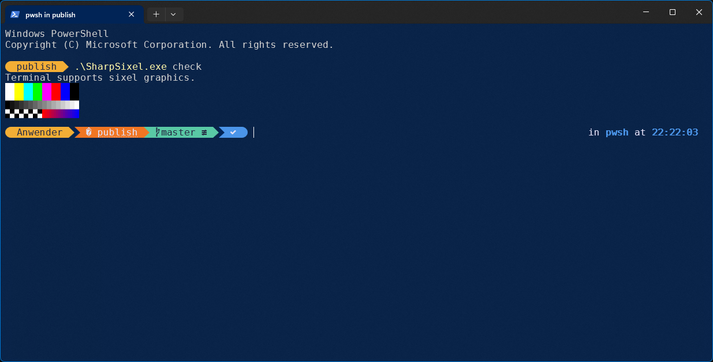
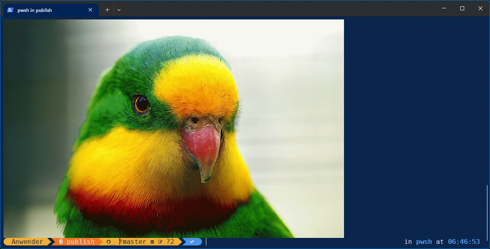
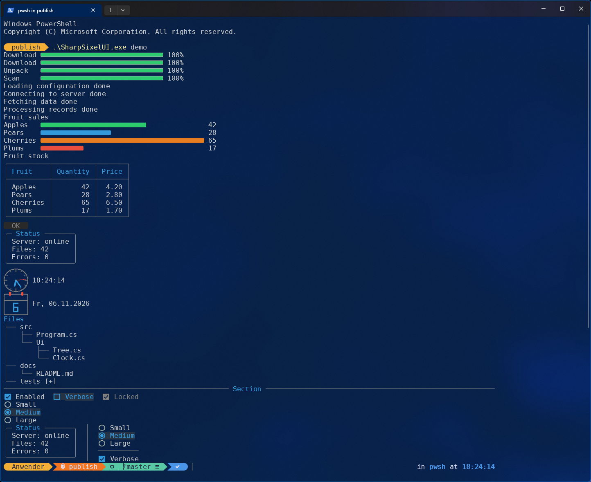
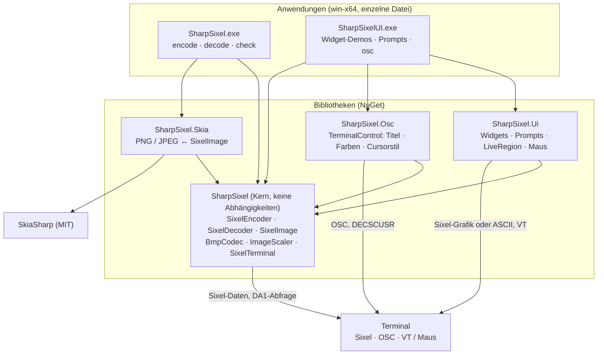

# SharpSixel

[English](README.md) | Deutsch

**Sixel-Grafiken für .NET: eine abhängigkeitsfreie Encoder-/Decoder-Bibliothek, PNG/JPEG-Unterstützung über SkiaSharp, ein Kommandozeilenprogramm, das Bilder direkt im Terminal anzeigt, Terminal-Widgets als Sixel-Grafik und Terminalsteuerung per OSC.**

[](https://github.com/feuster/SharpSixel/actions/workflows/dotnet.yml)
[](LICENSE)


[Sixel](https://en.wikipedia.org/wiki/Sixel) ist ein Bitmap-Grafikformat aus der Zeit der DEC-Terminals VT240/VT340.
Ein Bild wird durch druckbare Steuerzeichen beschrieben, sodass ein Terminal es direkt zeichnen kann, ohne externes
Anzeigeprogramm. Viele moderne Terminals unterstützen es (siehe [Terminal-Unterstützung](#terminal-unterstützung)).

## Inhalt

- [SharpSixel](#sharpsixel)
  - [Inhalt](#inhalt)
  - [Screenshots](#screenshots)
  - [Funktionen](#funktionen)
  - [Überblick](#überblick)
  - [Schnellstart](#schnellstart)
  - [Kommandozeile](#kommandozeile)
  - [Bibliothek](#bibliothek)
  - [Widgets](#widgets)
  - [Terminalsteuerung (OSC)](#terminalsteuerung-osc)
  - [Terminal-Unterstützung](#terminal-unterstützung)
  - [Build, Tests, Publish](#build-tests-publish)
  - [Projektstruktur](#projektstruktur)
  - [Dokumentation](#dokumentation)
  - [Grenzen und Status](#grenzen-und-status)
  - [Spezifikationen](#spezifikationen)
  - [Hinweis zur Nutzung von KI (freiwillig)](#hinweis-zur-nutzung-von-ki-freiwillig)
  - [Lizenz](#lizenz)


## Screenshots

```console
$ SharpSixel check
Terminal supports sixel graphics.
[ein kleines Testbild erscheint: Farbbalken, Graustufenverlauf, Schachbrett, Verlauf von Rot nach Blau]
```
*`SharpSixel check` im Windows Terminal: Das eingebaute Testbild wird als Sixel-Grafik gezeichnet.*


```console
$ SharpSixel encode foto.jpg --show --fit
[das Foto erscheint im Terminal, angepasst an die Fenstergröße]
```
*Ein Foto als Sixel-Grafik im Windows Terminal. Foto: ["The Superb Parrot"](https://creativecommons.org/publicdomain/zero/1.0/) von Bernard Spragg, CC0 1.0.*


```console
$ SharpSixelUI demo
[UI Widgets werden im terminal gezeigt]
```
*`SharpSixelUI demo` im Windows Terminal: das UI Demonstrator Program zeigt die UI Widgets live*


## Funktionen

**Encoder**
- Exakte Palette, wenn das Bild höchstens `MaxColors` Farben hat (bis 256), sonst Median-Cut-Quantisierung
- Dithering: Floyd-Steinberg (Fehlerdiffusion) oder geordnet mit 8x8-Bayer-Matrix (schneller, kleinere Ausgabe)
- Lauflängenkodierung, Raster Attributes (Größe und Seitenverhältnis), Transparenz (`P2 = 1`)

**Decoder**
- Vollständiges DECSIXEL: Farbregister (RGB und HLS mit der DEC-Farbtonkonvention), Wiederholung, Raster Attributes,
  Pixel-Seitenverhältnis, Hintergrundwahl, 7-Bit- und 8-Bit-Steuersequenzen
- Tolerant gegenüber unbekannten Zeichen und Zeilenumbrüchen; Größenlimits schützen vor fehlerhaften oder
  böswilligen Daten

**Weitere Bibliotheksfunktionen**
- `BmpCodec`: BMP lesen (1/4/8/16/24/32 Bit) und schreiben, eingebaut, ohne Abhängigkeiten
- `ImageScaler`: Flächenmittelwert beim Verkleinern, bilinear beim Vergrößern, Alpha-gewichtet
- `SixelTerminal`: Erkennung der Sixel-Unterstützung (DA1) und Abfrage der Pixelgröße, unabhängig von der
  Konsolen-Ein-/Ausgabe
- `SharpSixel.Skia`: PNG, JPEG und weitere Formate über [SkiaSharp](https://github.com/mono/SkiaSharp) (MIT)

**Kommandozeile**
- `encode`, `decode`, `check`; Bilder im Terminal anzeigen (`--show`), ans Fenster anpassen (`--fit`)
- Einzelne, eigenständige Windows-Exe, keine .NET-Installation nötig

**Widgets (`SharpSixel.Ui`, Demo: `SharpSixelUI.exe`)**
- Terminal-Widgets als Sixel-Grafik mit automatischem ASCII-Fallback: `ProgressBar`, `Spinner`, `StatusDisplay`, `BarChart`, `Table`, `Button`, `Panel`, `Clock`, `DateDisplay`, `Tree`, `Rule`, `CheckBox`, `RadioGroup`, `HorizontalLayout` / `VerticalLayout` (Widgets nebeneinander / untereinander), `ImageView`
- Interaktive Prompts mit Validierung: `Dialog`, `SelectionPrompt`, `MultiSelectionPrompt`, `TextPrompt`, `OpenFileDialog`, `SaveFileDialog`; Mausunterstützung
- Anpassbare Stile und Farben, Neuzeichnen an Ort und Stelle mit `LiveRegion`

**Terminalsteuerung (`SharpSixel.Osc`)**
- Fenstertitel, Vorder-, Hintergrund- und Cursorfarbe, Cursorstil und Zurücksetzen auf die Terminal-Standardwerte über OSC- und Cursorstil-Sequenzen

## Überblick

Pfeile zeigen von einem Projekt auf die Projekte, die es verwendet.



## Schnellstart

Repository klonen und die eigenständige Exe, die NuGet-Pakete und die Anleitungen nach `publish/` bauen
(benötigt das .NET-10-SDK):

```powershell
git clone https://github.com/feuster/SharpSixel.git
cd SharpSixel
./publish.ps1
```

Danach:

```powershell
cd publish
.\SharpSixel.exe check                              # unterstützt das Terminal Sixel? zeigt ein Testbild
.\SharpSixel.exe encode foto.jpg --show --fit       # Foto anzeigen, ans Terminal angepasst
.\SharpSixel.exe encode foto.png --width 800 --colors 64 --dither bayer -o foto.six
.\SharpSixel.exe encode foto.six --show             # gespeicherte Sixel-Datei anzeigen
.\SharpSixel.exe decode foto.six -o foto.png        # Sixel zurück in PNG
.\SharpSixelUI.exe demo                             # alle Widgets nacheinander
.\SharpSixelUI.exe progress --caption Upload --fill "#E67E22"
.\SharpSixelUI.exe osc                              # Titel, Farben und Cursorstil des Terminals
```

## Kommandozeile

```
SharpSixel encode <Eingabe> [-o <Datei>] [--show] [--colors <2-256>] [--dither [floyd|bayer|none]]
                  [--width <px>] [--height <px>] [--cols <n>] [--rows <n>] [--fit] [--upscale]
SharpSixel decode <Eingabe> -o <Datei|-> [--format bmp|png|jpg]   # .bmp, .png, .jpg; -o - schreibt nach stdout (Standard png)
SharpSixel check                         # Exit-Code 0, wenn das Terminal Sixel meldet; zeigt ein Testbild
```

| Option | Bedeutung |
|---|---|
| `<Eingabe>` | Dateipfad oder `-` für die Standardeingabe. `encode` liest BMP, PNG, JPEG (und weitere von SkiaSharp lesbare Formate) oder eine Sixel-Datei |
| `-o, --output <Datei>` | Ausgabedatei. Ohne `-o` schreibt `encode` das Sixel auf die Standardausgabe |
| `--show` | Nur bei `encode`: Anzeige im Terminal. Ohne `-o` wird nur angezeigt, mit `-o` wird gespeichert und angezeigt. Die Standardausgabe muss ein Terminal sein |
| `--colors <n>` | Höchstzahl der Palettenfarben, 2-256 (Standard 256) |
| `--dither [Modus]` | `floyd` (auch Standard bei einem einzelnen `--dither`), `bayer` oder `none` |
| `--width <px>`, `--height <px>` | Verkleinern bis zur Grenze, Seitenverhältnis bleibt erhalten |
| `--cols <n>`, `--rows <n>` | Wie `--width`/`--height`, aber in Terminal-Zeichenzellen (Terminal nötig; nicht mit der Pixel-Option derselben Achse kombinierbar) |
| `--fit` | In den darstellbaren Bereich des Terminals einpassen (wird beim Terminal abgefragt) |
| `--upscale` | Kleine Bilder bis zu den angegebenen Grenzen auch vergrößern |
| `--format <fmt>` | Nur `decode`: `bmp`, `png` oder `jpg`; überschreibt die Endung und wählt das Format für `-o -` (stdout, muss umgeleitet sein) |
| `-h, --help`, `--version` | Hilfe und Version |

Eine Sixel-Datei (Kopf `ESC P ... q`) wird bei `encode` als Eingabe akzeptiert: Sie wird Byte für Byte unverändert
ausgegeben, solange keine Größen-, Farb- oder Dithering-Option angegeben ist. Andernfalls wird sie dekodiert,
angepasst und neu enkodiert.

Exit-Codes: `0` Erfolg, `1` Laufzeitfehler (bei `check`: nicht unterstützt), `2` falsche Bedienung.

Die vollständige Anleitung mit Fehlerbehebung steht in [`docs/README.txt`](docs/README.txt) (Deutsch) und
[`docs/README.en.txt`](docs/README.en.txt) (Englisch).

## Bibliothek

Zielplattformen: `netstandard2.0` und `net10.0`. `SharpSixel` hat keine Abhängigkeiten; `SharpSixel.Skia` benötigt
SkiaSharp.

```csharp
using SharpSixel;
using SharpSixel.Skia;

// Beliebiges Bild laden, in 800x600 einpassen (Seitenverhältnis bleibt), als Sixel enkodieren
SixelImage image = SkiaImageCodec.Decode(File.ReadAllBytes("foto.png"));
image = ImageScaler.Fit(image, maxWidth: 800, maxHeight: 600);

var options = new SixelEncoderOptions { MaxColors = 64, Dithering = SixelDithering.Ordered };
string sixel = new SixelEncoder(options).Encode(image);
Console.Write(sixel);                                   // zeigt das Bild in einem Sixel-Terminal

// Und wieder zurück
SixelImage decoded = new SixelDecoder().Decode(sixel);
File.WriteAllBytes("out.png", SkiaImageCodec.Encode(decoded));
```

Ohne Skia decken `BmpCodec.Decode(bytes)` und `BmpCodec.Encode(image)` BMP-Dateien ab.

| Typ | Zweck |
|---|---|
| `SixelImage`, `SixelColor` | RGBA8888-Pixelpuffer (nicht vormultipliziertes Alpha) und Farbwert |
| `SixelEncoder`, `SixelEncoderOptions` | Bild zu Sixel: `MaxColors`, `AlphaThreshold`, `EmitRasterAttributes`, `Dithering` |
| `SixelDecoder`, `SixelDecoderOptions` | Sixel zu Bild: Größenlimits, Registerzahl, Hintergrundfarbe; `LooksLikeSixel` |
| `BmpCodec`, `ImageScaler` | BMP lesen/schreiben, `Resize` / `Fit` / `FitSize` (Seitenverhältnis bleibt, so groß wie möglich) und `Stretch` / `StretchSize` (Grenzen voll genutzt, Seitenverhältnis ignoriert) |
| `SixelTerminal`, `SixelTerminalInfo` | Abfrage von DA1, Pixelgröße, Farbregistern und Grafikgröße (XTSMGRAPHICS) sowie DECSDM / Modus 1070 |
| `SkiaImageCodec` (`SharpSixel.Skia`) | PNG/JPEG/... umwandeln und `SKBitmap`-Interop |
| `SixelException` | Ungültige Daten oder überschrittene Limits |

Die vier Pakete (`SharpSixel`, `SharpSixel.Skia`, `SharpSixel.Ui`, `SharpSixel.Osc`) werden lokal mit
`./publish.ps1` nach `publish/nuget/` gebaut und sind noch nicht auf nuget.org
veröffentlicht. Zum Verwenden diesen Ordner als lokale NuGet-Quelle eintragen.

## Widgets

`SharpSixel.Ui` zeichnet Terminal-Widgets als Sixel-Grafik. Unterstützt das Terminal kein Sixel oder ist die Ausgabe
umgeleitet, wird das Widget stattdessen aus ASCII-Zeichen aufgebaut. Stile und Farben sind anpassbar. Beschriftungen
und Wert-Texte sind normaler Terminaltext neben der Grafik. Das Paket hat die Zielplattformen `netstandard2.0` und
`net10.0` und hängt nur von `SharpSixel` ab.

| Widget | Zweck |
|---|---|
| `ProgressBar`, `ProgressGroup`, `Spinner` | Fortschritt mit optionaler Beschriftung und Prozent- oder Wertanzeige oder wanderndem Segment; mehrere Tasks untereinander; animierter Spinner |
| `StatusDisplay` | Spinner mit änderbarem Statustext für Arbeit unbekannter Dauer; Meldungen scrollen darüber |
| `BarChart` | Horizontales Balkendiagramm: Beschriftung, Balken, Wert |
| `Table` | Spaltenköpfe und ausgerichtete Textzellen im Raster, optional Streifen |
| `Button` | Beschriftung mit Zustand: normal, fokussiert, gedrückt, deaktiviert |
| `Panel` | Rahmen um Textzeilen mit optionalem Titel |
| `Clock`, `DateDisplay` | Analoguhr mit digitaler Zeit; Kalenderblatt mit Datumstext |
| `Tree` | Hierarchische Liste mit Führungslinien und einklappbaren Knoten |
| `Rule` | Trennlinie, waagerecht (optional mit Titel) oder senkrecht |
| `CheckBox`, `RadioGroup` | Kontrollkästchen; Radio-Optionen mit einer Auswahl |
| `HorizontalLayout`, `VerticalLayout` | Ordnet Widgets nebeneinander / untereinander an |
| `ImageView` | Bild, eingepasst in eine View fester Größe, optional mit Rahmen und eigenem Hintergrund |
| Prompts | `Dialog`, `SelectionPrompt<T>`, `MultiSelectionPrompt<T>`, `TextPrompt` mit Validierung, `OpenFileDialog` / `SaveFileDialog` |

`LiveRegion` zeichnet ein Widget an Ort und Stelle neu. Prompts, Dateidialoge und `Button` lassen sich per Maus
anklicken (`ShowWithMouse`, `LiveRegion.EnableMouse`, `VtInputParser`).

```csharp
using SharpSixel;
using SharpSixel.Ui;

SixelTerminalInfo? info = SixelTerminal.Query(Console.Out, readChar);   // readChar: Eingabefunktion, siehe Anleitung
var env = WidgetEnvironment.Create(RenderMode.Auto, info);               // Sixel, wenn unterstützt, sonst ASCII

var bar = new ProgressBar { Caption = "Download" };
bar.Style.FillColor = new SixelColor(230, 126, 34);

using (var region = new LiveRegion(Console.Out, env))
{
    region.Begin(bar.GetRows(env));
    for (int i = 0; i <= 100; i++)
    {
        bar.Value = i;
        region.Update(bar);
        Thread.Sleep(30);
    }
}

var fruit = new SelectionPrompt<string> { Title = "Lieblingsobst?" };
fruit.AddChoices(new[] { "Äpfel", "Birnen", "Pflaumen" });
string choice = fruit.Show(Console.Out, env);           // validierte Antwort
```

Das Demo-Programm `SharpSixelUI.exe` zeigt jedes Widget:

```
SharpSixelUI <progress|spinner|status|chart|table|button|panel|clock|date|tree|rule|checkbox|radio|layout|image|prompts|open|save|osc|demo> [Optionen]
```

Gemeinsame Optionen: `--mode auto|sixel|ascii`, `--caption <Text>`, `--duration <Sekunden>`, `--rows <n>`, `--no-mouse` und
Farben als `"#RRGGBB"` (in PowerShell in Anführungszeichen setzen). `prompts`, `open` und `save` sind interaktiv und
brauchen ein Terminal. Die vollständige Referenz (alle Widgets, Optionen, Typen) steht in
[`docs/README.Ui.txt`](docs/README.Ui.txt).

## Terminalsteuerung (OSC)

`SharpSixel.Osc` verändert das Aussehen des Terminals mit Operating System Commands (OSC) und Cursorstil-Sequenzen. Es
hängt nur von `SharpSixel` ab (wegen `SixelColor`). Alle Methoden sind statische Member von `TerminalControl`; jede
nimmt optional einen `TextWriter` (Standard `Console.Out`).

```csharp
using SharpSixel;
using SharpSixel.Osc;

TerminalControl.SetTitle("Mein Tool");                            // Steuerzeichen werden entfernt
TerminalControl.SetForegroundColor("#FFD700");                    // #RGB oder #RRGGBB, sonst ArgumentException
TerminalControl.SetBackgroundColor(new SixelColor(16, 32, 64));   // Alpha wird ignoriert
TerminalControl.SetCursorColor("#FF4040");
TerminalControl.SetCursorStyle(CursorStyle.BarBlinking);
TerminalControl.Reset();                                          // Farben und Cursorstil auf Standard, Titel unter Windows wiederhergestellt
```

| Methode | Sequenz |
|---|---|
| `SetTitle` / `ResetTitle` | OSC 0; `ResetTitle` stellt den früheren Titel wieder her (nur Windows, andere Plattformen können ihn nicht lesen) |
| `SetForegroundColor` / `ResetForegroundColor` | OSC 10 / 110 |
| `SetBackgroundColor` / `ResetBackgroundColor` | OSC 11 / 111 |
| `SetCursorColor` / `ResetCursorColor` | OSC 12 / 112 |
| `SetCursorStyle(CursorStyle)` | `CSI Ps SP q` (DECSCUSR): `Default`, `BoxBlinking`, `BoxStatic`, `UnderscoreBlinking`, `UnderscoreStatic`, `BarBlinking`, `BarStatic` |
| `Reset` | Titel, die drei Farben und der Cursorstil |

Das Terminal muss VT-Sequenzen verarbeiten (unter Windows aktivieren); Terminals ignorieren Sequenzen, die sie nicht
unterstützen. Die Demo ist `SharpSixelUI osc`.

## Terminal-Unterstützung

Terminals, die Sixel nach bisherigem Kenntnisstand unterstützen, sind unter anderem Windows Terminal (ab 1.22),
xterm (mit aktiviertem Sixel), WezTerm, foot, mlterm, Contour und iTerm2. Die Unterstützung hängt von Version und
Konfiguration ab; mit `SharpSixel check` lässt sich das sicher prüfen. Die klassische Windows-Konsole (conhost) zeigt
kein Sixel an.

## Build, Tests, Publish

```powershell
dotnet test                      # Unit-Tests
./publish.ps1                    # SharpSixel.exe, SharpSixelUI.exe, Anleitungen und NuGet-Pakete in publish/
./publish.ps1 -Version 0.2.0     # optionale Version für Exe und Pakete
```

Pack und Publish gibt es nur als Release-Build; ein Aufruf mit `-c Debug` wird abgelehnt. `publish/` enthält:

```
SharpSixel.exe              einzelne, eigenständige Datei, win-x64 (ca. 41 MB, komprimiert)
SharpSixelUI.exe            Widget-Demo, einzelne, eigenständige Datei, win-x64
README*.txt                 Anleitungen (Deutsch, Englisch; SharpSixel und SharpSixelUI)
nuget/                      Pakete SharpSixel, SharpSixel.Skia, SharpSixel.Ui und SharpSixel.Osc
```

Jeder Push und jeder Pull Request auf `master` wird von GitHub Actions gebaut und getestet
([`.github/workflows/dotnet.yml`](.github/workflows/dotnet.yml): `windows-latest`, .NET 10).

## Projektstruktur

```
src/SharpSixel/         Kernbibliothek (keine Abhängigkeiten)
src/SharpSixel.Skia/    SkiaSharp-Adapter (PNG/JPEG)
src/SharpSixel.Ui/      Terminal-Widgets (Sixel mit ASCII-Fallback)
src/SharpSixel.Osc/     Terminalsteuerung (OSC, Cursorstil)
src/SharpSixel.Cli/     Kommandozeilenprogramm (SharpSixel.exe)
src/SharpSixel.Cli.Ui/  Widget-Demo (SharpSixelUI.exe)
tests/SharpSixel.Tests/ xUnit-Tests
docs/                   Anleitungen und Sixel-Notizen
publish.ps1             Publish und Pack in einem Lauf
```

## Dokumentation

- [`docs/README.txt`](docs/README.txt): Benutzeranleitung (Deutsch)
- [`docs/README.en.txt`](docs/README.en.txt): user manual (English)
- [`docs/README.Ui.txt`](docs/README.Ui.txt): Anleitung für SharpSixelUI, SharpSixel.Ui und SharpSixel.Osc (Deutsch)
- [`docs/README.Ui.en.txt`](docs/README.Ui.en.txt): manual for SharpSixelUI, SharpSixel.Ui and SharpSixel.Osc (English)
- [`docs/all-about-sixels.txt`](docs/all-about-sixels.txt): Notizen zum Sixel-Format, als Ausgangspunkt verwendet

## Grenzen und Status

- Der Decoder akzeptiert Bilder bis 16384 x 16384 Pixel und insgesamt 64 Millionen Pixel (in der Bibliothek
  konfigurierbar).
- Der Encoder schreibt höchstens 256 Farben; es gibt keine Animationen und kein Interlacing.
- Gemessen auf einem Rechner (Release, .NET 10, verrauschtes 3840 x 2160-Testbild): Encodieren etwa 0,1 s ohne und
  etwa 0,2 s mit Floyd-Steinberg-Dithering, Decodieren etwa 0,15 s.
- Unter Windows verifiziert (Windows Terminal). Der Unix-Pfad für `check`, `--fit` und `--show` (Raw-Modus über
  `stty`) ist implementiert, aber noch nicht unter Linux oder macOS getestet. Unter Linux braucht die CLI zusätzlich
  `SkiaSharp.NativeAssets.Linux`.
- Veröffentlicht werden nur die Windows-Exes; andere Plattformen bauen aus dem Quellcode.
- Widgets, Prompts, Mauseingabe und OSC-Befehle sind nur im Windows Terminal verifiziert. Die Widgets gehen von einem Zeichen je Terminalzelle aus.

## Spezifikationen

- [Sixel (Wikipedia)](https://en.wikipedia.org/wiki/Sixel)
- [XTerm Control Sequences: Sixel Graphics](https://invisible-island.net/xterm/ctlseqs/ctlseqs.html#h3-Sixel-Graphics)
- [VT330/VT340 Programmer Reference Manual, Kapitel 14](https://www.vt100.net/docs/vt3xx-gp/chapter14.html)

Wo sich Quellen widersprechen (zum Beispiel bei der Tabelle des Pixel-Seitenverhältnisses für den Parameter `P1`),
wird dem VT330/VT340-Handbuch gefolgt.

## Hinweis zur Nutzung von KI (freiwillig)

Teile dieses Projekts (Quellcode, Tests und Dokumentation) wurden mit Unterstützung des KI-Sprachmodells Claude von
Anthropic erstellt (Claude Sonnet 5.5; es wurde ausschließlich diese eine Modellversion eingesetzt).

## Lizenz

[MIT](LICENSE), Copyright © 2026 Alexander Feuster, <https://github.com/feuster/SharpSixel>

SkiaSharp, das für die PNG/JPEG-Unterstützung verwendet wird, steht unter der MIT-Lizenz.
