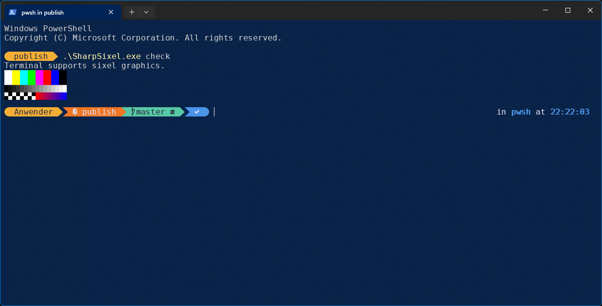
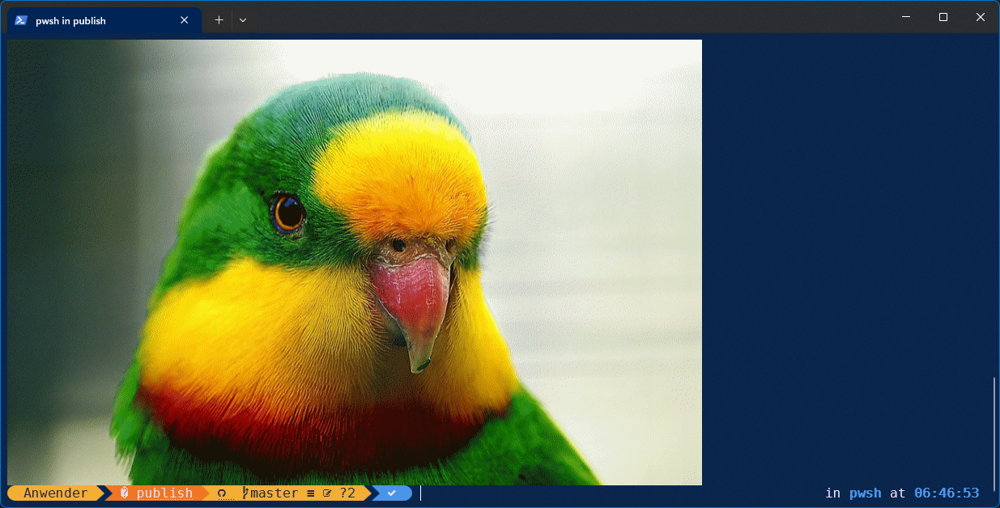
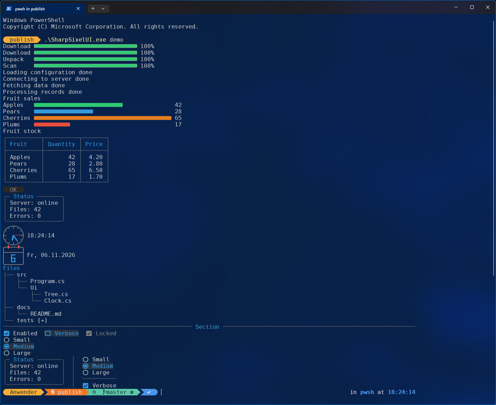
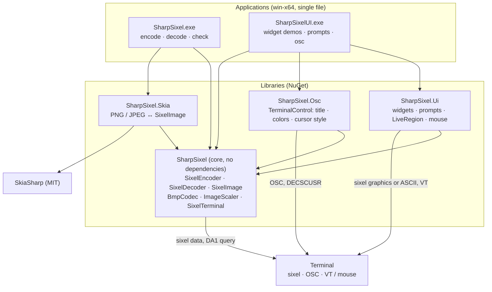

# SharpSixel

English | [Deutsch](README.de.md)

**Sixel graphics for .NET: a dependency-free encoder/decoder library, PNG/JPEG support via SkiaSharp, a command line tool that shows images right in your terminal, terminal widgets drawn as sixel graphics, and terminal control through OSC.**

[](https://github.com/feuster/SharpSixel/actions/workflows/dotnet.yml)
[](LICENSE)


[Sixel](https://en.wikipedia.org/wiki/Sixel) is a bitmap graphics format from the DEC VT240/VT340 era. An image is
described by printable control characters, so a terminal can draw it directly, with no external viewer. Many modern
terminals support it (see [Terminal support](#terminal-support)).

## Contents

- [SharpSixel](#sharpsixel)
  - [Contents](#contents)
  - [Screenshots](#screenshots)
  - [Features](#features)
  - [Overview](#overview)
  - [Quick start](#quick-start)
  - [Command line](#command-line)
  - [Library](#library)
  - [Widgets](#widgets)
  - [Terminal control (OSC)](#terminal-control-osc)
  - [Terminal support](#terminal-support)
  - [Build, test, publish](#build-test-publish)
  - [Project layout](#project-layout)
  - [Documentation](#documentation)
  - [Limits and status](#limits-and-status)
  - [Specifications](#specifications)
  - [Note on the use of AI (voluntary)](#note-on-the-use-of-ai-voluntary)
  - [License](#license)

## Screenshots

```console
$ SharpSixel check
Terminal supports sixel graphics.
[a small test pattern appears: color bars, gray ramp, checkerboard, red-to-blue gradient]
```
*`SharpSixel check` in Windows Terminal: the built-in test pattern is drawn as sixel graphics.*


```console
$ SharpSixel encode photo.jpg --show --fit
[the photo appears in the terminal, scaled to the window]
```

*A photo shown as sixel graphics in Windows Terminal. Photo: ["The Superb Parrot"](https://creativecommons.org/publicdomain/zero/1.0/) by Bernard Spragg, CC0 1.0.*


```console
$ SharpSixelUI demo
[UI widgets are shown in the terminal]
```
*`SharpSixelUI demo` in Windows Terminal: the UI demonstrator program showing the available widgets in live*


## Features

**Encoder**
- Exact palette if the image has at most `MaxColors` colors (up to 256), otherwise median-cut quantization
- Dithering: Floyd-Steinberg (error diffusion) or ordered 8x8 Bayer matrix (faster, smaller output)
- Run-length encoding, raster attributes (size and aspect ratio), transparency (`P2 = 1`)

**Decoder**
- Full DECSIXEL: color registers (RGB and HLS with the DEC hue convention), repeat, raster attributes, pixel aspect
  ratio, background select, 7-bit and 8-bit control sequences
- Tolerant of unknown characters and line breaks; size limits protect against malformed or malicious data

**Library extras**
- `BmpCodec`: BMP read (1/4/8/16/24/32 bit) and write, built in, no dependencies
- `ImageScaler`: area averaging when shrinking, bilinear when enlarging, alpha-aware
- `SixelTerminal`: sixel support detection (DA1) and pixel size query, independent of how you do console I/O
- `SharpSixel.Skia`: PNG, JPEG and other formats through [SkiaSharp](https://github.com/mono/SkiaSharp) (MIT)

**Command line**
- `encode`, `decode`, `check`; show images in the terminal (`--show`), fit them to the window (`--fit`)
- Single-file, self-contained Windows executable, no .NET installation needed

**Widgets (`SharpSixel.Ui`, demo: `SharpSixelUI.exe`)**
- Terminal widgets drawn as sixel graphics with automatic ASCII fallback: `ProgressBar`, `Spinner`, `StatusDisplay`, `BarChart`, `Table`, `Button`, `Panel`, `Clock`, `DateDisplay`, `Tree`, `Rule`, `CheckBox`, `RadioGroup`, `HorizontalLayout` / `VerticalLayout` (widgets side by side / stacked), `ImageView`
- Interactive prompts with validation: `Dialog`, `SelectionPrompt`, `MultiSelectionPrompt`, `TextPrompt`, `OpenFileDialog`, `SaveFileDialog`; mouse support
- Customizable styles and colors, in-place redraw with `LiveRegion`

**Terminal control (`SharpSixel.Osc`)**
- Window title, foreground, background and cursor color, cursor style, and reset to the terminal defaults through OSC and cursor style sequences

## Overview

Arrows point from a project to the projects it uses.



## Quick start

Clone the repository and build the standalone executable, the NuGet packages and the manuals into `publish/`
(requires the .NET 10 SDK):

```powershell
git clone https://github.com/feuster/SharpSixel.git
cd SharpSixel
./publish.ps1
```

Then:

```powershell
cd publish
.\SharpSixel.exe check                              # does the terminal support sixel? shows a test image
.\SharpSixel.exe encode photo.jpg --show --fit      # display a photo, fitted to the terminal
.\SharpSixel.exe encode photo.png --width 800 --colors 64 --dither bayer -o photo.six
.\SharpSixel.exe encode photo.six --show            # display a saved sixel file
.\SharpSixel.exe decode photo.six -o photo.png      # sixel back to PNG
.\SharpSixelUI.exe demo                             # all widgets one after another
.\SharpSixelUI.exe progress --caption Upload --fill "#E67E22"
.\SharpSixelUI.exe osc                              # title, colors and cursor style of the terminal
```

## Command line

```
SharpSixel encode <input> [-o <file>] [--show] [--colors <2-256>] [--dither [floyd|bayer|none]]
                  [--width <px>] [--height <px>] [--cols <n>] [--rows <n>] [--fit] [--upscale]
SharpSixel decode <input> -o <file|-> [--format bmp|png|jpg]   # .bmp, .png, .jpg; -o - writes to stdout (default png)
SharpSixel check                         # exit 0 if the terminal reports sixel support; shows a test image
```

| Option | Meaning |
|---|---|
| `<input>` | File path or `-` for stdin. `encode` reads BMP, PNG, JPEG (and other formats SkiaSharp can read) or a sixel file |
| `-o, --output <file>` | Output file. Without `-o`, `encode` writes the sixel to stdout |
| `--show` | `encode` only: display in the terminal. Without `-o` it is only displayed, with `-o` it is saved and displayed. stdout must be a terminal |
| `--colors <n>` | Maximum palette colors, 2-256 (default 256) |
| `--dither [mode]` | `floyd` (also the default for a bare `--dither`), `bayer`, or `none` |
| `--width <px>`, `--height <px>` | Shrink to fit, aspect ratio kept |
| `--cols <n>`, `--rows <n>` | Like `--width`/`--height`, but in terminal character cells (needs a terminal; not combinable with the pixel option of the same axis) |
| `--fit` | Fit into the terminal's drawable area (queried from the terminal) |
| `--upscale` | Also enlarge small images up to the given limits |
| `--format <fmt>` | `decode` only: `bmp`, `png` or `jpg`; overrides the extension and selects the format for `-o -` (stdout, must be redirected) |
| `-h, --help`, `--version` | Help and version |

A sixel file (header `ESC P ... q`) is accepted as input for `encode`: it is passed through byte for byte unless size,
color or dithering options are given, in which case it is decoded, adjusted and encoded again.

Exit codes: `0` success, `1` runtime error (or `check`: not supported), `2` usage error.

The complete user manual, including troubleshooting, is in [`docs/README.en.txt`](docs/README.en.txt)
(German: [`docs/README.txt`](docs/README.txt)).

## Library

Targets `netstandard2.0` and `net10.0`. `SharpSixel` has no dependencies; `SharpSixel.Skia` needs SkiaSharp.

```csharp
using SharpSixel;
using SharpSixel.Skia;

// Load any image, fit it into 800x600 (aspect ratio kept), encode it as sixel
SixelImage image = SkiaImageCodec.Decode(File.ReadAllBytes("photo.png"));
image = ImageScaler.Fit(image, maxWidth: 800, maxHeight: 600);

var options = new SixelEncoderOptions { MaxColors = 64, Dithering = SixelDithering.Ordered };
string sixel = new SixelEncoder(options).Encode(image);
Console.Write(sixel);                                   // shows the image in a sixel terminal

// And back again
SixelImage decoded = new SixelDecoder().Decode(sixel);
File.WriteAllBytes("out.png", SkiaImageCodec.Encode(decoded));
```

Without Skia, `BmpCodec.Decode(bytes)` / `BmpCodec.Encode(image)` cover BMP files.

| Type | Purpose |
|---|---|
| `SixelImage`, `SixelColor` | RGBA8888 pixel buffer (straight alpha) and color value |
| `SixelEncoder`, `SixelEncoderOptions` | Image to sixel: `MaxColors`, `AlphaThreshold`, `EmitRasterAttributes`, `Dithering` |
| `SixelDecoder`, `SixelDecoderOptions` | Sixel to image: size limits, register count, background color; `LooksLikeSixel` |
| `BmpCodec`, `ImageScaler` | BMP read/write, `Resize` / `Fit` / `FitSize` (aspect ratio kept, as large as possible) and `Stretch` / `StretchSize` (limits used completely, aspect ratio ignored) |
| `SixelTerminal`, `SixelTerminalInfo` | DA1, pixel size, color register and graphics size (XTSMGRAPHICS) and DECSDM / mode 1070 query |
| `SkiaImageCodec` (`SharpSixel.Skia`) | PNG/JPEG/... conversion and `SKBitmap` interop |
| `SixelException` | Invalid data or exceeded limits |

The four packages (`SharpSixel`, `SharpSixel.Skia`, `SharpSixel.Ui`, `SharpSixel.Osc`) are built locally by
`./publish.ps1` into `publish/nuget/` and are not published on nuget.org yet. To use
them, add that folder as a local NuGet source.

## Widgets

`SharpSixel.Ui` draws terminal widgets as sixel graphics. If the terminal does not support sixel, or the output is
redirected, the widget is built from ASCII characters instead. Styles and colors are customizable. Captions and value
texts are normal terminal text next to the graphic. The package targets `netstandard2.0` and `net10.0` and depends only
on `SharpSixel`.

| Widget | Purpose |
|---|---|
| `ProgressBar`, `ProgressGroup`, `Spinner` | Progress with optional caption and percent or value text or a moving segment; several tasks below each other; animated spinner |
| `StatusDisplay` | Spinner with a changeable status text for work of unknown duration; messages scroll above it |
| `BarChart` | Horizontal bar chart: label, bar, value |
| `Table` | Column headers and aligned text cells in a grid, optional stripes |
| `Button` | Label with state: normal, focused, pressed, disabled |
| `Panel` | Frame around text lines with an optional title |
| `Clock`, `DateDisplay` | Analog clock with digital time; calendar page with the date text |
| `Tree` | Hierarchical list with guide lines and collapsible nodes |
| `Rule` | Separator line, horizontal (optional title) or vertical |
| `CheckBox`, `RadioGroup` | Check box; radio options with one selected |
| `HorizontalLayout`, `VerticalLayout` | Places widgets side by side / on top of each other |
| `ImageView` | Image fitted into a view of fixed size, optional frame and own background |
| Prompts | `Dialog`, `SelectionPrompt<T>`, `MultiSelectionPrompt<T>`, `TextPrompt` with validation, `OpenFileDialog` / `SaveFileDialog` |

`LiveRegion` redraws a widget in place. Prompts, file dialogs and `Button` can be clicked with the mouse
(`ShowWithMouse`, `LiveRegion.EnableMouse`, `VtInputParser`).

```csharp
using SharpSixel;
using SharpSixel.Ui;

SixelTerminalInfo? info = SixelTerminal.Query(Console.Out, readChar);   // readChar: input function, see the manual
var env = WidgetEnvironment.Create(RenderMode.Auto, info);               // sixel if supported, otherwise ASCII

var bar = new ProgressBar { Caption = "Download" };
bar.Style.FillColor = new SixelColor(230, 126, 34);

using (var region = new LiveRegion(Console.Out, env))
{
    region.Begin(bar.GetRows(env));
    for (int i = 0; i <= 100; i++)
    {
        bar.Value = i;
        region.Update(bar);
        Thread.Sleep(30);
    }
}

var fruit = new SelectionPrompt<string> { Title = "Favorite fruit?" };
fruit.AddChoices(new[] { "Apples", "Pears", "Plums" });
string choice = fruit.Show(Console.Out, env);           // validated answer
```

The demo program `SharpSixelUI.exe` shows every widget:

```
SharpSixelUI <progress|spinner|status|chart|table|button|panel|clock|date|tree|rule|checkbox|radio|layout|image|prompts|open|save|osc|demo> [options]
```

Common options: `--mode auto|sixel|ascii`, `--caption <text>`, `--duration <seconds>`, `--rows <n>`, `--no-mouse` and colors
as `"#RRGGBB"` (quote them in PowerShell). `prompts`, `open` and `save` are interactive and need a terminal. The full
reference (all widgets, options, types) is in [`docs/README.Ui.en.txt`](docs/README.Ui.en.txt).

## Terminal control (OSC)

`SharpSixel.Osc` changes the look of the terminal with Operating System Commands (OSC) and cursor style sequences. It
depends only on `SharpSixel` (for `SixelColor`). All methods are static members of `TerminalControl`; each takes an
optional `TextWriter` (default `Console.Out`).

```csharp
using SharpSixel;
using SharpSixel.Osc;

TerminalControl.SetTitle("My tool");                              // control characters are removed
TerminalControl.SetForegroundColor("#FFD700");                    // #RGB or #RRGGBB, otherwise ArgumentException
TerminalControl.SetBackgroundColor(new SixelColor(16, 32, 64));   // alpha is ignored
TerminalControl.SetCursorColor("#FF4040");
TerminalControl.SetCursorStyle(CursorStyle.BarBlinking);
TerminalControl.Reset();                                          // colors and cursor style to the defaults, title restored on Windows
```

| Method | Sequence |
|---|---|
| `SetTitle` / `ResetTitle` | OSC 0; `ResetTitle` restores the earlier title (Windows only, other platforms cannot read it) |
| `SetForegroundColor` / `ResetForegroundColor` | OSC 10 / 110 |
| `SetBackgroundColor` / `ResetBackgroundColor` | OSC 11 / 111 |
| `SetCursorColor` / `ResetCursorColor` | OSC 12 / 112 |
| `SetCursorStyle(CursorStyle)` | `CSI Ps SP q` (DECSCUSR): `Default`, `BoxBlinking`, `BoxStatic`, `UnderscoreBlinking`, `UnderscoreStatic`, `BarBlinking`, `BarStatic` |
| `Reset` | Title, the three colors and the cursor style |

The terminal must process VT sequences (enable them on Windows); terminals ignore sequences they do not support. The
demo is `SharpSixelUI osc`.

## Terminal support

Terminals known to support sixel include Windows Terminal (1.22 or later), xterm (with sixel enabled), WezTerm,
foot, mlterm, Contour and iTerm2. Support depends on version and configuration, so run `SharpSixel check` to be sure.
The classic Windows console host (conhost) does not display sixel.

## Build, test, publish

```powershell
dotnet test                      # unit tests
./publish.ps1                    # SharpSixel.exe, SharpSixelUI.exe, manuals and NuGet packages in publish/
./publish.ps1 -Version 0.2.0     # optional version for exe and packages
```

Pack and publish are Release-only; a `-c Debug` call is rejected. `publish/` contains:

```
SharpSixel.exe              single-file, self-contained, win-x64 (about 41 MB, compressed)
SharpSixelUI.exe            widget demo, single-file, self-contained, win-x64
README*.txt                 user manuals (German, English; SharpSixel and SharpSixelUI)
nuget/                      SharpSixel, SharpSixel.Skia, SharpSixel.Ui and SharpSixel.Osc packages
```

Every push and pull request to `master` is built and tested by GitHub Actions
([`.github/workflows/dotnet.yml`](.github/workflows/dotnet.yml): `windows-latest`, .NET 10).

## Project layout

```
src/SharpSixel/         core library (no dependencies)
src/SharpSixel.Skia/    SkiaSharp adapter (PNG/JPEG)
src/SharpSixel.Ui/      terminal widgets (sixel with ASCII fallback)
src/SharpSixel.Osc/     terminal control (OSC, cursor style)
src/SharpSixel.Cli/     command line tool (SharpSixel.exe)
src/SharpSixel.Cli.Ui/  widget demo (SharpSixelUI.exe)
tests/SharpSixel.Tests/ xUnit tests
docs/                   user manuals and sixel notes
publish.ps1             publish + pack in one run
```

## Documentation

- [`docs/README.en.txt`](docs/README.en.txt): user manual (English)
- [`docs/README.txt`](docs/README.txt): Benutzeranleitung (Deutsch)
- [`docs/README.Ui.en.txt`](docs/README.Ui.en.txt): manual for SharpSixelUI, SharpSixel.Ui and SharpSixel.Osc (English)
- [`docs/README.Ui.txt`](docs/README.Ui.txt): Anleitung für SharpSixelUI, SharpSixel.Ui und SharpSixel.Osc (Deutsch)
- [`docs/all-about-sixels.txt`](docs/all-about-sixels.txt): sixel format notes used as a starting point

## Limits and status

- The decoder accepts images up to 16384 x 16384 pixels and 64 million pixels in total (configurable in the library).
- The encoder writes at most 256 colors; there are no animations and no interlacing.
- Measured on one machine (Release, .NET 10, noisy 3840 x 2160 test image): encoding about 0.1 s without and about
  0.2 s with Floyd-Steinberg dithering, decoding about 0.15 s.
- Verified on Windows (Windows Terminal). The Unix code path for `check`, `--fit` and `--show` (raw mode via `stty`) is
  implemented but not yet tested on Linux or macOS. On Linux the CLI additionally needs `SkiaSharp.NativeAssets.Linux`.
- Only the Windows executables are published; other platforms build from source.
- Widgets, prompts, mouse input and OSC commands are verified in Windows Terminal only. The widgets assume one character per terminal cell.

## Specifications

- [Sixel (Wikipedia)](https://en.wikipedia.org/wiki/Sixel)
- [XTerm Control Sequences: Sixel Graphics](https://invisible-island.net/xterm/ctlseqs/ctlseqs.html#h3-Sixel-Graphics)
- [VT330/VT340 Programmer Reference Manual, chapter 14](https://www.vt100.net/docs/vt3xx-gp/chapter14.html)

Where sources disagree (for example the pixel aspect ratio table for the `P1` parameter), the VT330/VT340 manual is
followed.

## Note on the use of AI (voluntary)

Parts of this project (source code, tests and documentation) were created with the assistance of the AI language model
Claude by Anthropic (Claude Sonnet 5.5; only this one model version was used).

## License

[MIT](LICENSE), Copyright © 2026 Alexander Feuster, <https://github.com/feuster/SharpSixel>

SkiaSharp, used for PNG/JPEG support, is licensed under the MIT license.
